**Computer Forensics Case Studies**

Case Study 3 — Investigating Suspected Illegal File Transfer From Memory Evidence

<table>
<tr><th>**Field**</th><th>**Detail**</th></tr>
<tr><td>Student name</td><td>Basiru Aliyu</td></tr>
<tr><td>Registration number</td><td>FWSD2511424</td></tr>
<tr><td>Course code</td><td>SBT-DF204 — Computer Forensics Case Studies</td></tr>
<tr><td>Case title</td><td>Investigating Suspected Illegal File Transfer From Memory Evidence</td></tr>
<tr><td>Evidence analysed</td><td>memdumpWin7.mem (Windows 7 memory image)</td></tr>
<tr><td>Tool</td><td>Volatility Foundation Volatility Framework 2.6.1</td></tr>
<tr><td>Date of analysis</td><td>18/10/2026</td></tr>
</table>

# 1. Executive Conclusion

The memory image is a Windows 7 SP1 x86 system (computer name IE8WIN7) running inside a VirtualBox virtual machine, captured at 2019-01-06 15:09:06 UTC. The evidence supports the following sequence. A USB mass-storage device (“General UDisk USB Device”) was registered on the system at about 15:02:54 UTC and was assigned drive letter F:. The user profile IEUser interacted with that volume (MountPoints2 key “F”, last updated 15:03:06 UTC). A command prompt hosted by conhost.exe (PID 3988, started 15:06:11 UTC) then holds a command history of three entries: ipconfig, cd Downloads, and copy secret_file.docx F:. Because the drive letter F: maps to the USB device in the MountedDevices key, the command history is consistent with an attempt to copy a document named secret_file.docx to the removable device between 15:06:11 UTC and the capture time of 15:09:06 UTC.

This is a possible transfer attempt, not proof of a completed transfer: the supplied output contains no console output confirming the copy, no listing of the F: volume, and no ShellBag entry for the F: drive or the Downloads folder in the rows captured. The evidence also identifies a workstation profile (IEUser), not a named person.

**Confidence level: moderate that a copy to the removable device was attempted from the IEUser session; low that the copy completed; low for attributing the action to a specific individual. See Section 6 for limitations.**

# 2. Evidence Acquisition and Integrity

<table>
<tr><th>**Field**</th><th>**Value**</th></tr>
<tr><td>Original file name</td><td>memdumpWin7.mem</td></tr>
<tr><td>Source</td><td>Course-supplied link (Dropbox), retrieved with wget on 2026-10-18 01:08:57 (Figure 1)</td></tr>
<tr><td>Download recorded by wget</td><td>93,959 bytes (91.76 KB), content type reported as text/html (see integrity note below)</td></tr>
<tr><td>Working copy</td><td>working/memdump_working.mem, created with cp --preserve=timestamps (Figure 3)</td></tr>
<tr><td>SHA-256 recorded</td><td>0d448762ac70bbfdfd608d0e7cf56f594684fb755560efcbdcd90cb853b61d6c (of working/memdump_working.mem, Figure 2)</td></tr>
<tr><td>Image analysed by Volatility</td><td>~/Downloads/memdumpWin7.mem (path shown in imageinfo, Figure 4)</td></tr>
<tr><td>Tools</td><td>Volatility Foundation Volatility Framework 2.6.1; sha256sum; wget; Kali Linux (ICDFA lab)</td></tr>
</table>

## 2.1 Download

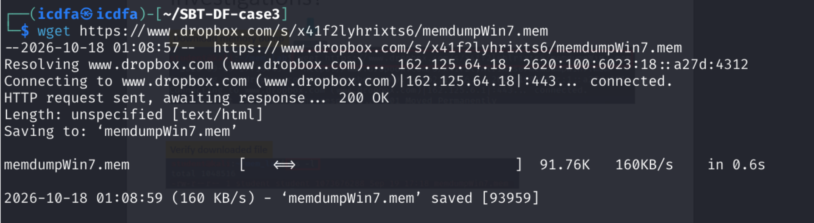

*Figure 1 (E01). wget of memdumpWin7.mem into ~/SBT-DF-case3. The transfer is reported as Length: unspecified [text/html], 93,959 bytes saved.*

## 2.2 Hash and Working Copy

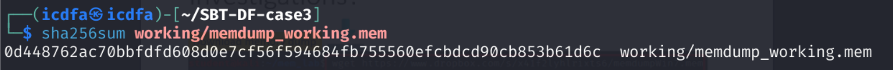

*Figure 2 (E02). sha256sum of working/memdump_working.mem.*

*Figure 3 (E03). cp --preserve=timestamps memdumpWin7.mem working/memdump_working.mem.*

*.*

# 3. Method and Profile Selection

Analysis used Volatility 2.6.1 from the command line against the memory image. Each plugin was run with the profile selected below. Registry keys were read with printkey; where a key lives in a specific hive, the hive offsets in Figure 6 (hivelist) identify it. Time is treated as UTC throughout; local time is recorded only where imageinfo reports it.

## 3.1 imageinfo Result

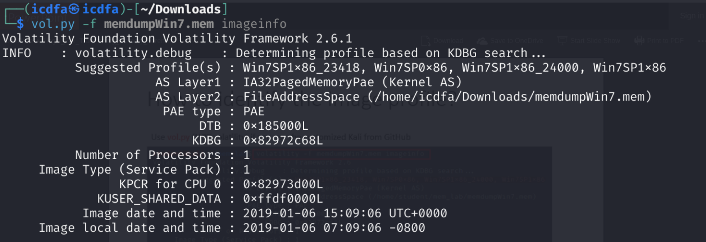

*Figure 4 (E04). vol.py -f memdumpWin7.mem imageinfo. Suggested profiles, DTB, KDBG, processor count and image time are shown.*

<table>
<tr><th>**Item**</th><th>**Value (from imageinfo, Figure 4)**</th></tr>
<tr><td>Candidate profiles</td><td>Win7SP1x86_23418, Win7SP0x86, Win7SP1x86_24000, Win7SP1x86</td></tr>
<tr><td>Selected profile</td><td>Win7SP1x86_23418</td></tr>
<tr><td>Address-space layers</td><td>IA32PagedMemoryPae (Kernel AS); FileAddressSpace</td></tr>
<tr><td>PAE type / processors</td><td>PAE / 1</td></tr>
<tr><td>DTB / KDBG</td><td>0x185000 / 0x82972c68</td></tr>
<tr><td>Image date and time (UTC)</td><td>2019-01-06 15:09:06 UTC+0000</td></tr>
<tr><td>Image local date and time</td><td>2019-01-06 07:09:06 -0800 (recorded separately; UTC is used for all analysis)</td></tr>
</table>

## 3.2 Profile Validation

The imageinfo suggestion was validated by using the selected profile with several further plugins, each of which returned coherent results: printkey returned readable registry hives and key names (Figure 5), hivelist returned valid hive paths with virtual and physical offsets (Figure 6), and pslist returned a valid System process with a plausible PID, parent, thread and handle count (Figure 17). Coherent output across independent plugins supports the selected profile. Win7SP1x86_23418 was used throughout without error.

Operating-system discrepancy: the case scenario refers to a Windows 10 memory image, while the case materials and the file name describe Windows 7. The Volatility output supports Windows 7 (a Win7SP1 x86 profile) and this report follows the output rather than the scenario wording.

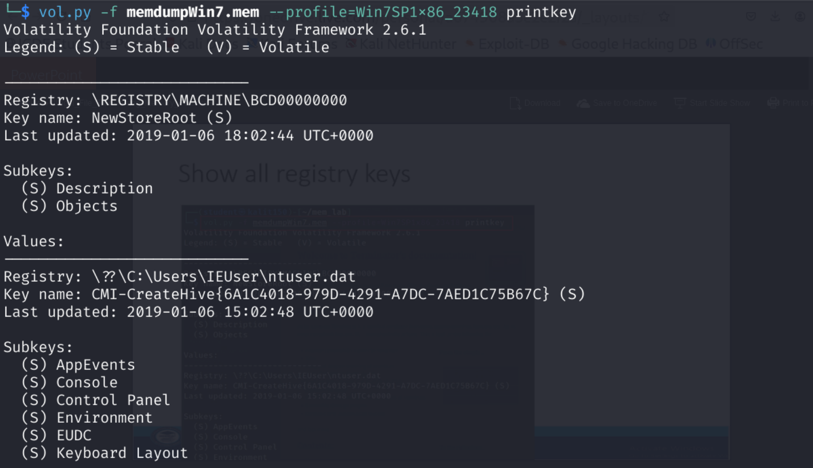

*Figure 5 (E05). printkey (no key specified) with profile Win7SP1x86_23418, returning coherent registry data (BCD and IEUser ntuser.dat roots).*

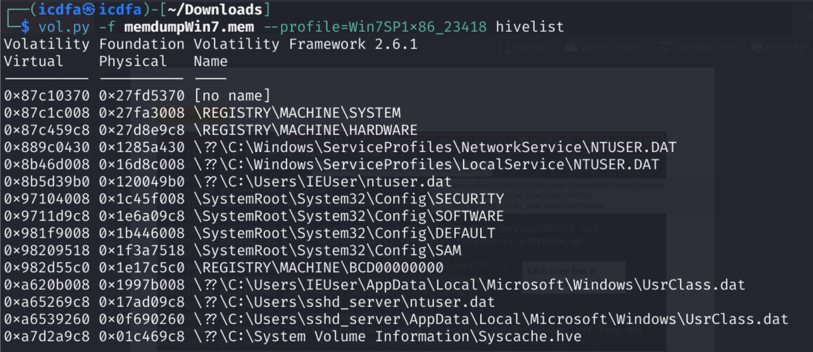

*Figure 6 (E06). hivelist. Virtual/physical offsets and paths for SYSTEM, HARDWARE, SECURITY, SOFTWARE, SAM, DEFAULT, and the ntuser.dat and UsrClass.dat hives of IEUser and sshd_server.*

## 3.3 Plugins Used

<table>
<tr><th>**Plugin**</th><th>**Purpose in this investigation**</th></tr>
<tr><td>imageinfo</td><td>Profile candidates, DTB/KDBG, image time (UTC and local)</td></tr>
<tr><td>hivelist</td><td>Locate registry hives and their offsets</td></tr>
<tr><td>printkey (-K)</td><td>ProfileList, Volatile Environment, Winlogon, hardware, USBSTOR, DeviceClasses, MountedDevices, MountPoints2</td></tr>
<tr><td>netscan</td><td>TCP/UDP socket artefacts and owning processes</td></tr>
<tr><td>pslist (-p)</td><td>Process identity, parent and start time for PID 4 and PID 3988</td></tr>
<tr><td>cmdscan</td><td>Command history recovered from console structures</td></tr>
<tr><td>shellbags (--output=html)</td><td>Folder-view history for File Explorer</td></tr>
</table>

# 4. Findings

## 4.1 Question 1 — What evidence image did you acquire and how did you preserve it?

The image is memdumpWin7.mem, retrieved by wget and copied with timestamps preserved to working/memdump_working.mem; its SHA-256 is recorded in Section 2 (E01–E03). The integrity limitation in Section 2.3 applies: the recorded hash is for the working copy in ~/SBT-DF-case3, and the analysed file in ~/Downloads was not separately hashed in the screenshots.

## 4.2 Question 2 — What operating-system profile and image time are supported?

Profile Win7SP1x86_23418 is supported (Section 3.1, E04), validated by printkey, hivelist and pslist (E05, E06, E17). The image time is 2019-01-06 15:09:06 UTC, which is 07:09:06 at UTC−0800 as reported by the image itself. All times in this report are UTC.

## 4.3 Question 3 — What user and account artefacts are relevant?

The Volatile Environment key for the logged-on profile (printkey → \??\C:\Users\IEUser\ntuser.dat) records USERNAME = IEUser, USERDOMAIN and LOGONSERVER = IE8WIN7, and USERPROFILE = C:\Users\IEUser (E07). The ProfileList key in the SOFTWARE hive lists two user SIDs, S-1-5-21-1716914095-909560446-1177810406-1000 and …-1002, alongside the built-in S-1-5-18, -19 and -20 (E08). The SID ending -1000 maps to ProfileImagePath C:\Users\IEUser, with its key last updated 2019-01-06 15:07:15 UTC (E09). hivelist also shows a second profile, sshd_server (E06); the supplied output does not map SID …-1002 to a profile path, so that mapping is not asserted.

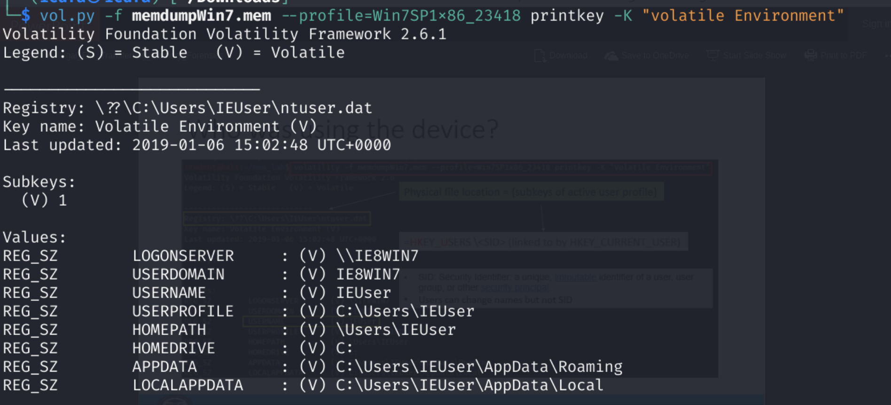

*Figure 7 (E07). printkey -K "volatile Environment" on IEUser's ntuser.dat: IEUser, domain/logon server IE8WIN7.*

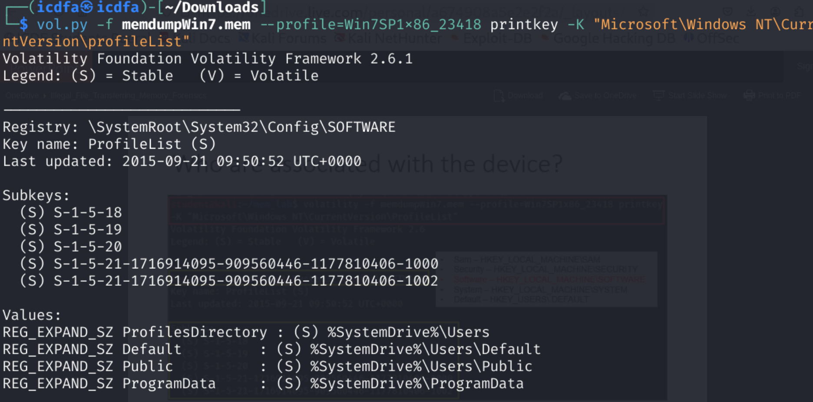

*Figure 8 (E08). ProfileList in the SOFTWARE hive: SIDs S-1-5-18/19/20 and S-1-5-21-…-1000 and -1002.*

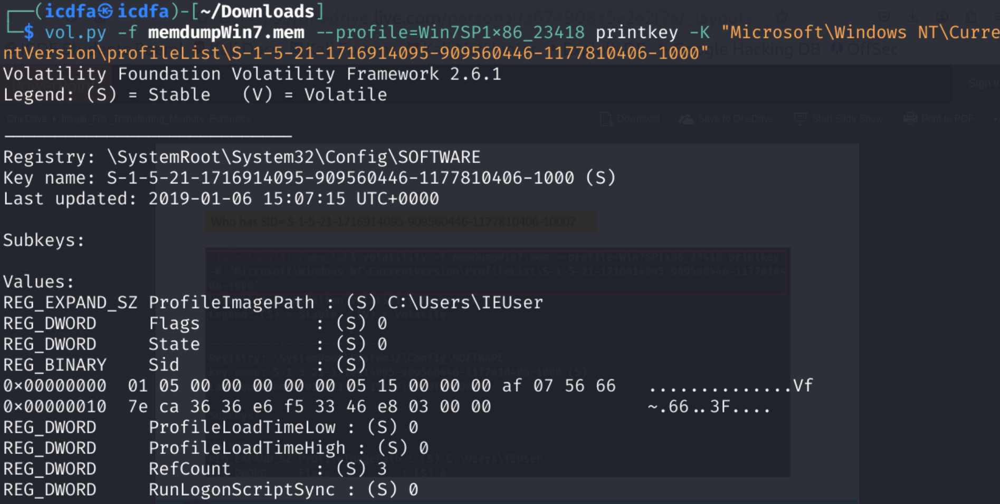

*Figure 9 (E09). ProfileList\S-1-5-21-1716914095-909560446-1177810406-1000: ProfileImagePath C:\Users\IEUser, key last updated 15:07:15 UTC.*

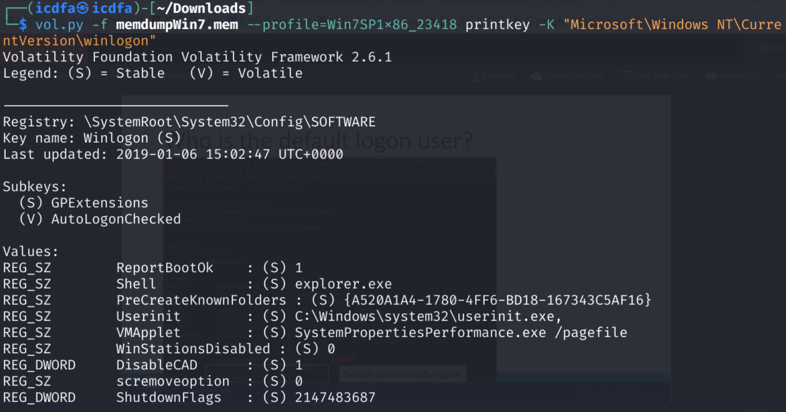

*Figure 10 (E10). Winlogon key (last updated 15:02:47 UTC). The captured portion shows Shell, Userinit and related values; no default-user value is visible in the portion captured.*

<table>
<tr><th>**Artefact**</th><th>**Registry path / hive**</th><th>**Value**</th><th>**UTC time**</th><th>**Evidence**</th></tr>
<tr><td>Logged-on user</td><td>ntuser.dat (IEUser) \Volatile Environment</td><td>USERNAME = IEUser; domain IE8WIN7</td><td>2019-01-06 15:02:48</td><td>E07</td></tr>
<tr><td>IEUser SID</td><td>SOFTWARE \...\ProfileList\S-1-5-21-1716914095-909560446-1177810406-1000</td><td>ProfileImagePath = C:\Users\IEUser</td><td>2019-01-06 15:07:15</td><td>E09</td></tr>
<tr><td>Other SID</td><td>SOFTWARE \...\ProfileList</td><td>S-1-5-21-…-1002 (path not shown)</td><td>2015-09-21 09:50:52 (parent key)</td><td>E08</td></tr>
<tr><td>Hive of interest</td><td>\??\C:\Users\IEUser\ntuser.dat</td><td>Virtual offset 0x8b5d39b0</td><td>—</td><td>E06</td></tr>
<tr><td>Second profile</td><td>\??\C:\Users\sshd_server\ntuser.dat</td><td>Virtual offset 0xa65269c8</td><td>—</td><td>E06</td></tr>
</table>

Limit: these records identify account and profile information on the workstation. They do not identify the person who was using the account at the time; a shared password, an unlocked session or remote access (an sshd service is present, see Section 4.5) would produce the same artefacts.

### 4.3.1 Workstation Identification (Supporting Evidence)

The hardware keys describe the machine. The CentralProcessor key reports Intel(R) Core(TM) i7-7700 CPU @ 3.60GHz (GenuineIntel, x86 Family 6 Model 158 Stepping 9) (E11). The SystemBiosVersion value is ‘VBOX - 1’ with SystemBiosDate 06/23/99, which indicates an Oracle VirtualBox virtual machine; the reported CPU is therefore the processor presented to the guest (E12). The ControlSet001\Enum key lists device classes including PCI, IDE, STORAGE and USBSTOR (E13), PCI vendor/device identifiers are in E14, and the ComputerName is IE8WIN7 (E15).

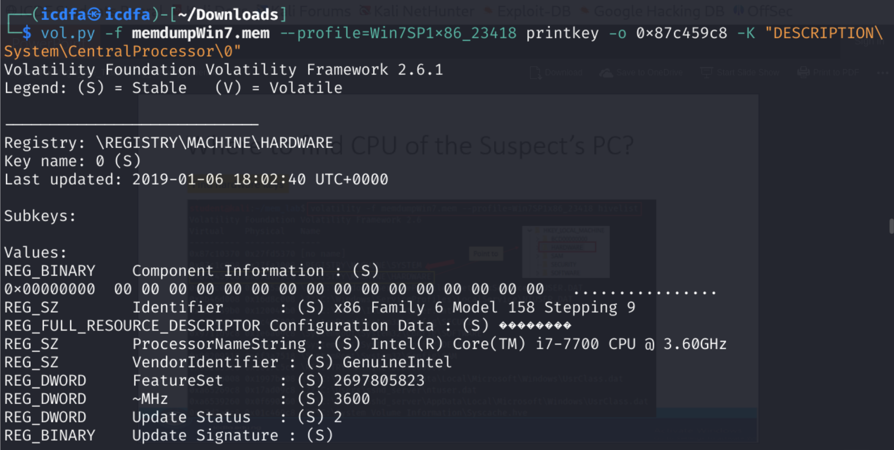

*Figure 11 (E11). printkey -o 0x87c459c8 -K "DESCRIPTION\System\CentralProcessor\0".*

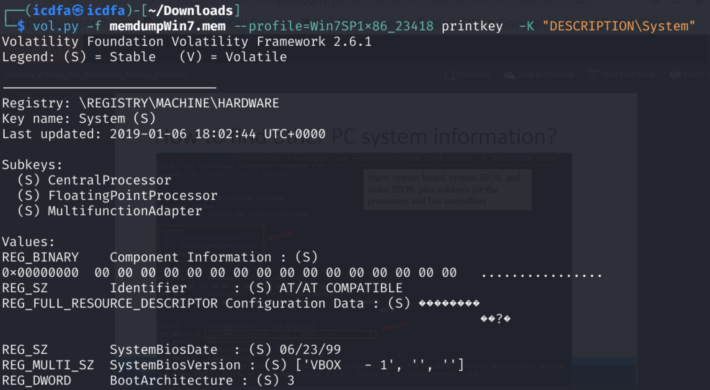

*Figure 12 (E12). printkey -K "DESCRIPTION\System": SystemBiosVersion ‘VBOX - 1’, BIOS date 06/23/99.*

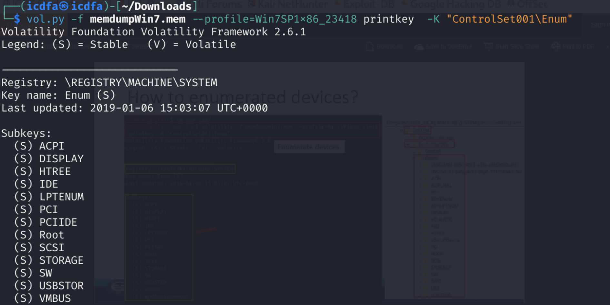

*Figure 13 (E13). printkey -K "ControlSet001\Enum": ACPI, DISPLAY, IDE, PCI, SCSI, STORAGE, USBSTOR, VMBUS and others.*

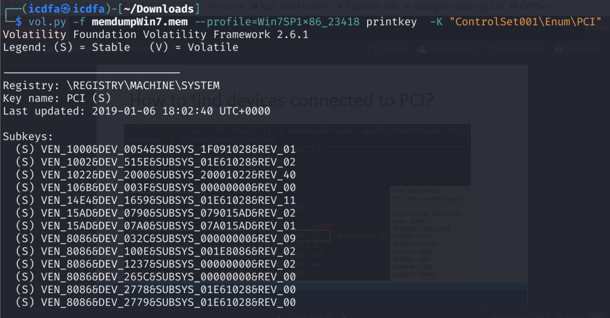

*Figure 14 (E14). printkey -K "ControlSet001\Enum\PCI": PCI vendor/device identifiers (e.g. VEN_8086, VEN_15AD).*

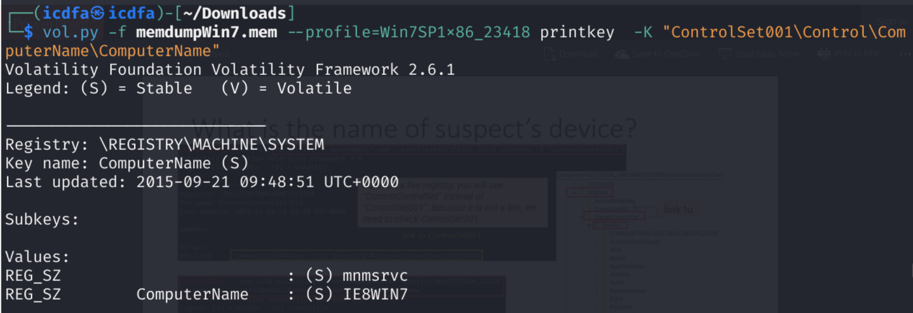

*Figure 15 (E15). printkey -K "ControlSet001\Control\ComputerName\ComputerName": ComputerName = IE8WIN7.*

## 4.4 Question 4 — What process and network evidence relates to a potential download or transfer?

netscan, filtered to TCPv4 records, shows only sockets in the LISTENING state with a foreign address of 0.0.0.0:0 (E16). These include 0.0.0.0:49152–49156 owned by wininit.exe (PID 340), svchost.exe (PID 880 and others), services.exe (PID 432) and lsass.exe (PID 440), 0.0.0.0:135 owned by svchost.exe (PID 672), and 0.0.0.0:445 and 192.168.56.8:139 owned by System (PID 4). pslist -p 4 confirms PID 4 is System, parent PID 0, with 73 threads and 518 handles (E17). The local address 192.168.56.8 is the workstation's address on the 192.168.56.x network seen in the output.

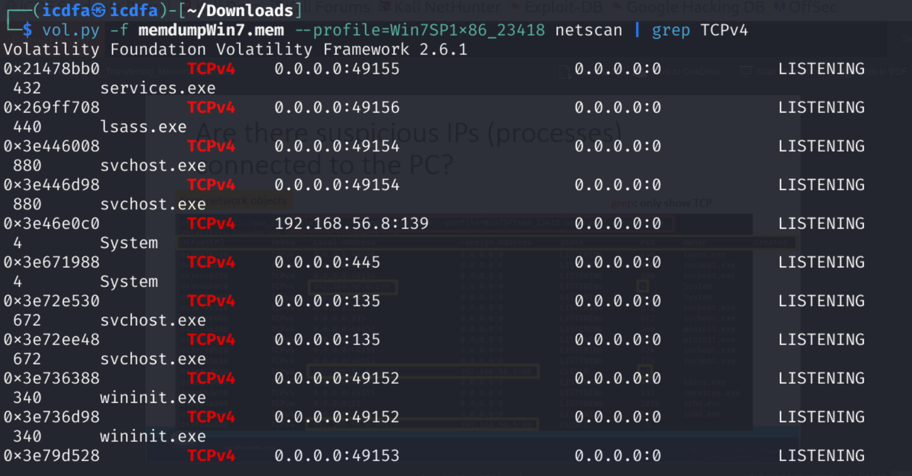

*Figure 16 (E16). netscan | grep TCPv4: listening sockets with owning processes and PIDs.*

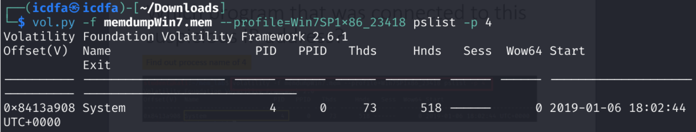

*Figure 17 (E17). pslist -p 4: System, PID 4, PPID 0, 73 threads, 518 handles, start 2019-01-06 18:02:44 UTC.*

No ESTABLISHED connection, no remote (foreign) IP address, and no browser or file-transfer process appears in the portion of netscan output captured, so this output does not by itself identify a suspicious remote endpoint or a download. These are listening sockets of standard Windows services; they are not evidence of a transfer. No address was contacted during this examination.

Timing observation: pslist shows System (PID 4) with a start time of 2019-01-06 18:02:44 UTC, and several registry keys (BCD, HARDWARE, PCI, CentralProcessor) have last-updated times of 18:02:40–18:02:44 UTC, all later than the image capture time of 15:09:06 UTC reported by imageinfo. Meanwhile, user-session records (e.g. conhost.exe PID 3988 at 15:06:11 UTC) fall before the capture time. This inconsistency is not resolved by the supplied output and may reflect virtual-machine clock changes or how timestamps were recorded. It is noted as a limitation rather than explained by assumption.

## 4.5 Question 5 — What does command history show?

cmdscan found two console histories (E18). The relevant one belongs to conhost.exe PID 3988 (CommandHistory 0x110448, Application: cmd.exe, Flags: Allocated, Reset, CommandCount 3, LastAdded 2, LastDisplayed 2). Its entries are:

Cmd #0 @ 0x10dc40:  ipconfig  
Cmd #1 @ 0x107f90:  cd Downloads  
Cmd #2 @ 0x1147a0:  copy secret_file.docx F:

pslist -p 3988 shows conhost.exe started at 2019-01-06 15:06:11 UTC with parent PID 348 (E19). The history therefore originates from a command-prompt session that began at 15:06:11 UTC, before the 15:09:06 UTC capture. cmdscan does not give a timestamp for individual commands, so the three commands are placed within that window by inference, not directly observed times. The drive letter F: in the copy command corresponds to the USB device in MountedDevices (Section 4.6).

A second history belongs to conhost.exe PID 2000 for the application sshd.exe, with CommandCount 0 and unreadable entries. It shows that an SSH service host was present on the machine, relevant to the shared or remote-access limitation in Section 6.

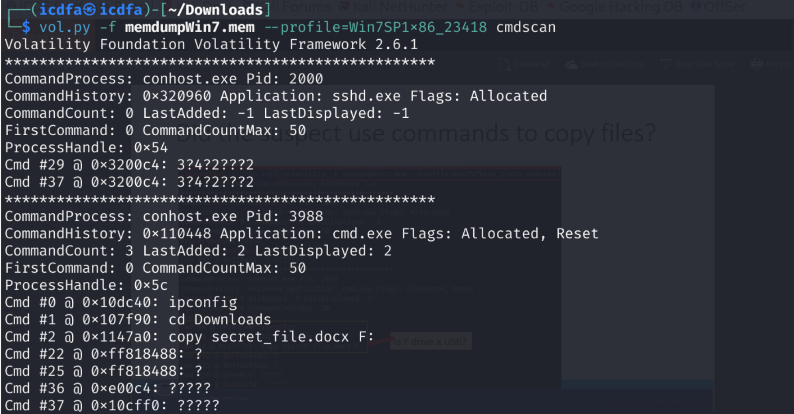

*Figure 18 (E18). cmdscan: PID 3988 (cmd.exe) history ipconfig / cd Downloads / copy secret_file.docx **F:;** PID 2000 (sshd.exe) with no readable commands.*

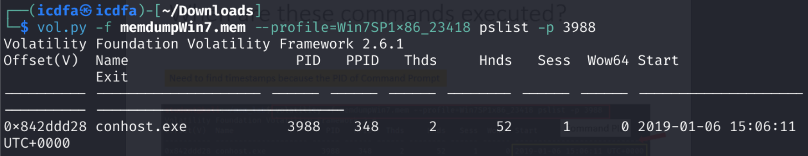

*Figure 19 (E19). pslist -p 3988: conhost.exe, PPID 348, started 2019-01-06 15:06:11 UTC.*

*Limit: the copy command string does not prove the copy succeeded. The consoles plugin, which can show the screen buffer and any result message, is not among the supplied output, so no confirming or failing output for the copy is shown.*

## 4.6 Question 6 — What removable-media evidence is present?

The following registry artefacts relate a USB storage device, a drive letter and a user profile.

<table>
<tr><th>**Artefact**</th><th>**Registry path**</th><th>**Observed value**</th><th>**UTC (key last updated)**</th><th>**Evidence**</th></tr>
<tr><td>USBSTOR device class</td><td>SYSTEM \ControlSet001\Enum\USBSTOR</td><td>Subkey Disk&amp;Ven_General&amp;Prod_UDisk&amp;Rev_5.00</td><td>2019-01-06 15:02:54</td><td>E21</td></tr>
<tr><td>Instance ID</td><td>…\USBSTOR\Disk&amp;Ven_General&amp;Prod_UDisk&amp;Rev_5.00</td><td>Subkey 6&amp;1bec0f48&amp;0&amp;_&amp;0 (as displayed)</td><td>2019-01-06 15:02:54</td><td>E22</td></tr>
<tr><td>Friendly name / class</td><td>…\6&amp;1bec0f48&amp;0&amp;_&amp;0</td><td>FriendlyName = General UDisk USB Device; Class = DiskDrive; Service = disk; ContainerID {421e7e37-11dd-11e9-b3cf-806e6f6e6963}</td><td>2019-01-06 15:02:54</td><td>E23</td></tr>
<tr><td>Device interfaces</td><td>SYSTEM \ControlSet001\Control\DeviceClasses</td><td>Device-interface GUID subkeys present</td><td>2019-01-06 15:03:08</td><td>E20</td></tr>
<tr><td>Drive-letter mapping</td><td>SYSTEM \MountedDevices</td><td>\DosDevices\F: → USBSTOR#Disk&amp;Ven_General&amp;Prod_UDisk&amp;Rev_5.00#6&amp;1bec0f48&amp;0&amp;_&amp;0#{53f56307-…}</td><td>2019-01-06 15:02:54</td><td>E24</td></tr>
<tr><td>User mount record (volumes)</td><td>IEUser ntuser.dat \Software\Microsoft\Windows\CurrentVersion\Explorer\MountPoints2</td><td>Subkeys include CPC, F, and several volume GUIDs</td><td>2019-01-06 15:03:07</td><td>E25</td></tr>
<tr><td>User mount record (F)</td><td>…\MountPoints2\F</td><td>Key “F” present under IEUser's hive</td><td>2019-01-06 15:03:06</td><td>E26</td></tr>
</table>

Together these show: a USB storage device identified as General UDisk (Rev 5.00) was registered (USBSTOR, 15:02:54 UTC); drive letter F: was mapped to that device (MountedDevices); and the IEUser profile has a MountPoints2 record for volume F (15:03:06 UTC), which is the artefact that ties the volume to that user profile. The last-updated time of a key indicates when the key was last modified, usually tied to the device's most recent connection, but it is not on its own an exact connection time. The instance ID is shown as 6&amp;1bec0f48&amp;0&amp;_&amp;0 in the output.

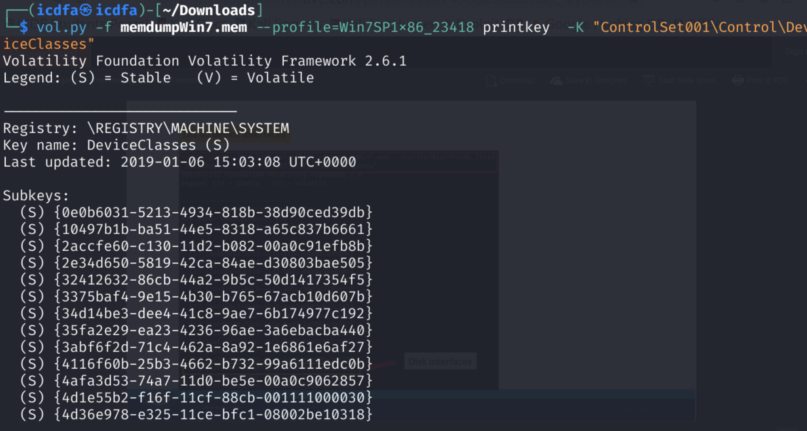

*Figure 20 (E20). printkey -K "ControlSet001\Control\DeviceClasses" (last updated 15:03:08 UTC).*

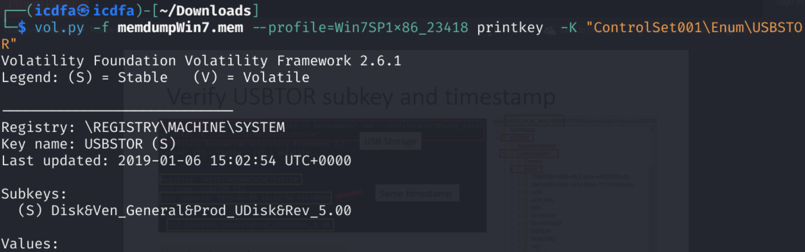

*Figure 21 (E21). printkey -K "ControlSet001\Enum\USBSTOR": subkey Disk&amp;Ven_General&amp;Prod_UDisk&amp;Rev_5.00 (15:02:54 UTC).*

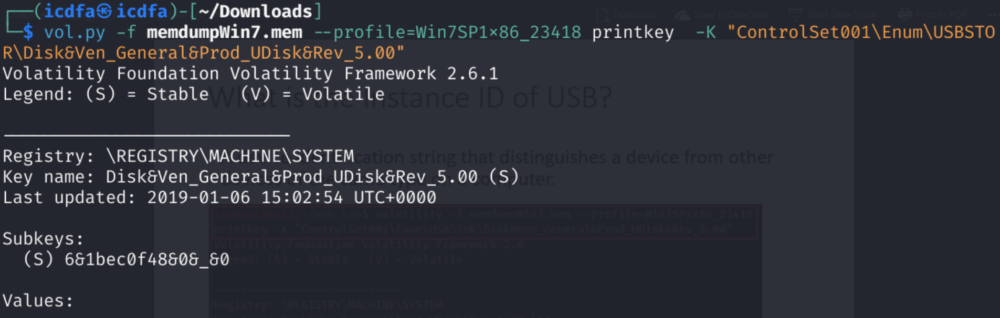

*Figure 22 (E22). USBSTOR device key: instance subkey 6&amp;1bec0f48&amp;0&amp;_&amp;0.*

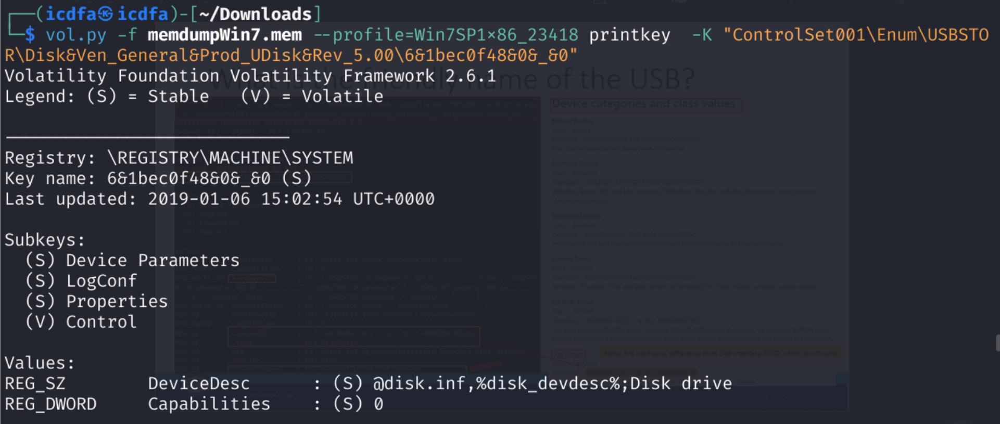

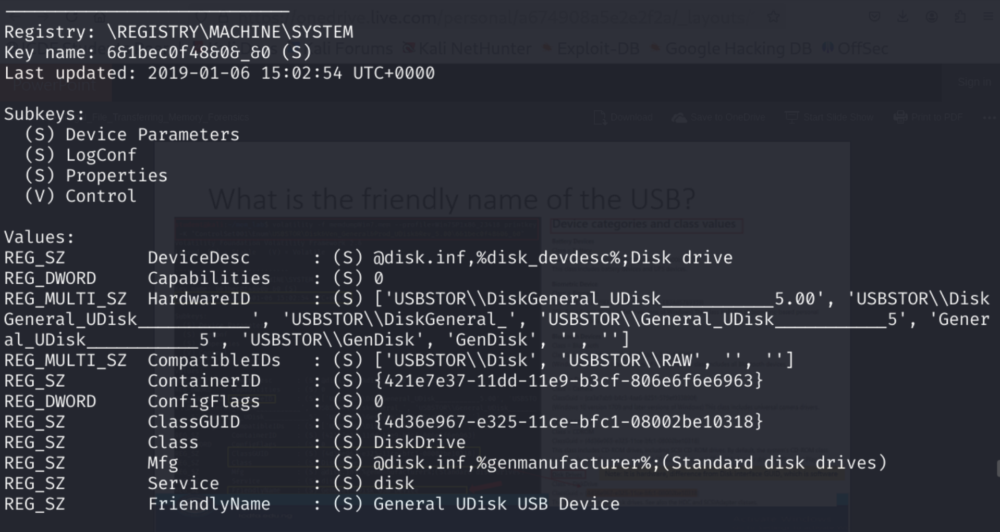

*Figure 23 (E23). Instance key: DeviceDesc, HardwareID, ContainerID, Class = DiskDrive, Service = disk, FriendlyName = General UDisk USB Device.*

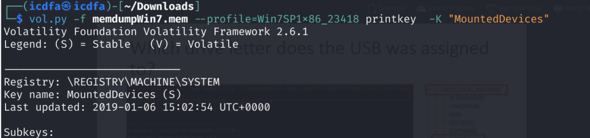

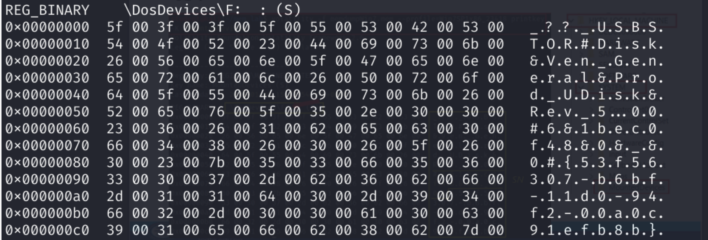

*Figure 24 (E24). printkey -K "MountedDevices" (15:02:54 UTC) and the value \DosDevices\F: containing the USBSTOR device path (hex dump decodes to USBSTOR#Disk&amp;Ven_General&amp;Prod_UDisk&amp;Rev_5.00#6&amp;1bec0f48&amp;0&amp;_&amp;0**#{**53f56307-…}).*

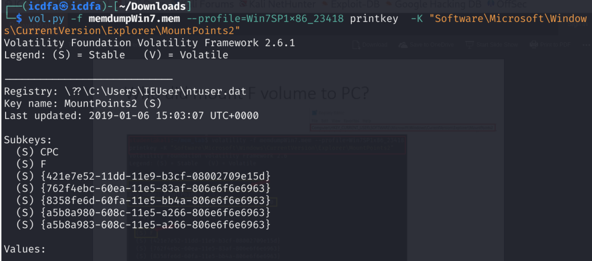

*Figure 25 (E25). **printkey** on IEUser's MountPoints2: subkeys CPC, F and volume GUIDs (15:03:07 UTC).*

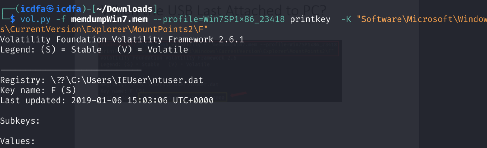

*Figure 26 (E26). **printkey** on MountPoints2\F in IEUser's ntuser.dat (last updated 15:03:06 UTC).*

*Limit: USBSTOR, MountedDevices and MountPoints2 show that a device was registered, a letter assigned and a profile interacted with the volume. They do not prove physical possession of the device, the identity of the person who inserted it, or that any file was written **to** it.*

## 4.7 Question 7 — What File Explorer evidence supports the sequence?

shellbags was run with HTML output (E27) and the table reviewed in a browser (E28). The rows visible in the captured screenshots are in IEUser's UsrClass.dat under Local Settings\Software\Microsoft\Windows\Shell\BagMRU. Entries Users, BGinfo, Windows, Drivers and PerfLogs (under BagMRU\0\1) have a LastWrite of 2019-01-06 15:04:40 UTC. Other visible entries (support, 32Bit, 64Bit, IEUser, x86) have LastWrite times in September 2015 (2015-09-21 22:28:44 to 2015-09-22 08:12:00 UTC).

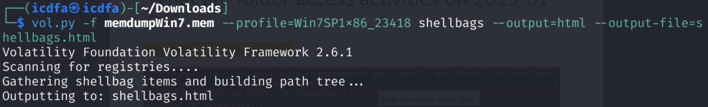

*Figure 27 (E27). vol.py ... shellbags --output=html --output-file=shellbags.html.*

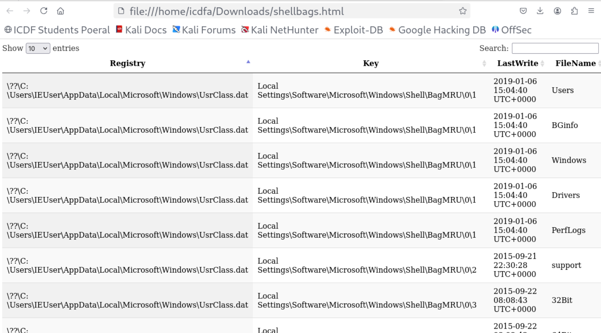

*Figure 28 (E28). shellbags.html: IEUser UsrClass.dat BagMRU rows with LastWrite 2019-01-06 15:04:40 UTC (first rows).*

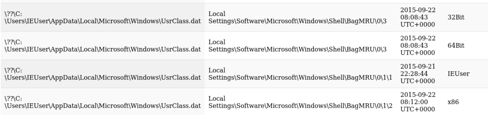

*Figure 29 (E28). shellbags.html: further rows (32Bit, 64Bit, IEUser, x86; 2015 LastWrite times).*

Interpretation: the 15:04:40 UTC entries show Explorer folder-view records for several folders on the C: drive were written at that time, which falls after the F: volume mount records (15:03:06–15:03:07 UTC) and before the command prompt started (15:06:11 UTC). ShellBag times are folder-view or preference evidence; they are not file-modification times and do not show that any file was copied. In the rows captured, no entry refers to the F: drive or to a Downloads folder, so ShellBags do not by themselves confirm the Downloads-to-F: sequence suggested by the command history. Searching the full table for “Downloads” and “F:” would address this.

## 4.8 Question 8 — What conclusion can you defend?

The defensible conclusion is the one in Section 1: the artefacts are consistent with an attempted copy of secret_file.docx from the Downloads folder to the removable volume F: from a command prompt session under the IEUser profile, but completion and the identity of the person are not established. The UTC timeline is in Section 5 and the limitations are in Section 6.

# 5. Timeline (UTC)

All times are UTC. “Observed” entries are directly shown by Volatility output; “Interpretation” states what they are taken to mean and the limit of that reading.

<table>
<tr><th>**Stage**</th><th>**UTC timestamp**</th><th>**Ev. ID**</th><th>**Source artefact**</th><th>**Observed fact**</th><th>**Interpretation and limit**</th></tr>
<tr><td>Account / session</td><td>2019-01-06 15:02:47–15:02:48</td><td>E10, E07</td><td>Winlogon; IEUser Volatile Environment</td><td>Key last-updated times; USERNAME = IEUser</td><td>Marks the IEUser session context around this time; key write times, not logon time</td></tr>
<tr><td>Removable-device evidence</td><td>2019-01-06 15:02:54</td><td>E21–E24</td><td>USBSTOR; MountedDevices</td><td>General UDisk device key and \DosDevices\F: mapping last updated</td><td>USB device registered and mapped to F:; last-write, not a precise connection time</td></tr>
<tr><td>Drive mapping</td><td>2019-01-06 15:03:06–15:03:07</td><td>E25, E26</td><td>IEUser MountPoints2 (F)</td><td>MountPoints2\F key present, updated 15:03:06</td><td>IEUser profile interacted with volume F; does not show a file written</td></tr>
<tr><td>Device interfaces</td><td>2019-01-06 15:03:08</td><td>E20</td><td>DeviceClasses</td><td>Key last updated</td><td>Corroborates device registration</td></tr>
<tr><td>Download-folder review</td><td>2019-01-06 15:04:40</td><td>E28</td><td>ShellBags (BagMRU\0\1)</td><td>Folder-view entries for Users, BGinfo, Windows, Drivers, PerfLogs</td><td>Folder-view evidence only; no Downloads or F: entry in rows captured</td></tr>
<tr><td>Process evidence</td><td>2019-01-06 15:06:11</td><td>E19</td><td>pslist -p 3988</td><td>conhost.exe PID 3988 started</td><td>Command-prompt session begins; owner account not shown in supplied output</td></tr>
<tr><td>Command-history evidence</td><td>Between 15:06:11 and 15:09:06 (inferred)</td><td>E18</td><td>cmdscan (PID 3988)</td><td>ipconfig; cd Downloads; copy secret_file.docx F:</td><td>Copy to F: attempted in this session; per-command times not recorded; completion not shown</td></tr>
<tr><td>Profile record</td><td>2019-01-06 15:07:15</td><td>E09</td><td>ProfileList (SID …-1000)</td><td>Key last updated</td><td>Profile record for IEUser updated; not tied to a specific action</td></tr>
<tr><td>Capture</td><td>2019-01-06 15:09:06</td><td>E04</td><td>imageinfo</td><td>Image date/time</td><td>Moment memory was captured; later events cannot be observed</td></tr>
<tr><td>Timestamp anomaly</td><td>2019-01-06 18:02:40–18:02:44</td><td>E17, E11, E12</td><td>pslist (System); HARDWARE keys</td><td>System start and hardware keys later than capture time</td><td>Unexplained; possible clock or recording effect; not used to support the sequence</td></tr>
<tr><td>Supported conclusion</td><td>—</td><td>E18, E24, E26</td><td>Correlation of above</td><td>Command copy to F: and F: mapped to USB for IEUser</td><td>Possible transfer attempt only; not proof of completion or of a named person</td></tr>
</table>

# 6. Attribution Assessment

### Observed facts

F: is mapped to the USB device General UDisk (MountedDevices), and IEUser's MountPoints2 holds a record for F.

conhost.exe PID 3988 (cmd.exe), started 15:06:11 UTC, has history including copy secret_file.docx F:.

The image was captured at 15:09:06 UTC; no output confirming or refuting completion of the copy was captured.

# Appendix A — Evidence Log

<table>
<tr><th>**Evidence ID**</th><th>**Tool and plugin**</th><th>**Source record or path**</th><th>**Observed fact**</th><th>**Figure**</th></tr>
<tr><td>E01</td><td>wget</td><td>memdumpWin7.mem download</td><td>93,959 bytes, text/html reported</td><td>Fig. 1</td></tr>
<tr><td>E02</td><td>sha256sum</td><td>working/memdump_working.mem</td><td>0d448762…b61d6c</td><td>Fig. 2</td></tr>
<tr><td>E03</td><td>cp --preserve=timestamps</td><td>working copy</td><td>Working copy created</td><td>Fig. 3</td></tr>
<tr><td>E04</td><td>Volatility imageinfo</td><td>memdumpWin7.mem</td><td>Win7SP1x86_23418; 2019-01-06 15:09:06 UTC</td><td>Fig. 4</td></tr>
<tr><td>E05</td><td>Volatility printkey</td><td>registry roots</td><td>Coherent output validates profile</td><td>Fig. 5</td></tr>
<tr><td>E06</td><td>Volatility hivelist</td><td>hive offsets</td><td>IEUser ntuser.dat 0x8b5d39b0; SYSTEM 0x87c1c008</td><td>Fig. 6</td></tr>
<tr><td>E07</td><td>printkey Volatile Environment</td><td>ntuser.dat (IEUser)</td><td>USERNAME IEUser; IE8WIN7</td><td>Fig. 7</td></tr>
<tr><td>E08</td><td>printkey ProfileList</td><td>SOFTWARE hive</td><td>SIDs -1000 and -1002</td><td>Fig. 8</td></tr>
<tr><td>E09</td><td>printkey ProfileList\SID-1000</td><td>SOFTWARE hive</td><td>C:\Users\IEUser; 15:07:15 UTC</td><td>Fig. 9</td></tr>
<tr><td>E10</td><td>printkey Winlogon</td><td>SOFTWARE hive</td><td>Updated 15:02:47 UTC</td><td>Fig. 10</td></tr>
<tr><td>E11</td><td>printkey CentralProcessor</td><td>HARDWARE hive</td><td>Intel Core i7-7700 @ 3.60GHz</td><td>Fig. 11</td></tr>
<tr><td>E12</td><td>printkey DESCRIPTION\System</td><td>HARDWARE hive</td><td>BIOS VBOX - 1</td><td>Fig. 12</td></tr>
<tr><td>E13</td><td>printkey Enum</td><td>SYSTEM hive</td><td>Device classes incl. USBSTOR</td><td>Fig. 13</td></tr>
<tr><td>E14</td><td>printkey Enum\PCI</td><td>SYSTEM hive</td><td>PCI vendor/device IDs</td><td>Fig. 14</td></tr>
<tr><td>E15</td><td>printkey ComputerName</td><td>SYSTEM hive</td><td>IE8WIN7</td><td>Fig. 15</td></tr>
<tr><td>E16</td><td>Volatility netscan</td><td>TCPv4 sockets</td><td>Listening sockets only; 192.168.56.8:139</td><td>Fig. 16</td></tr>
<tr><td>E17</td><td>Volatility pslist -p 4</td><td>PID 4</td><td>System; start 18:02:44 UTC</td><td>Fig. 17</td></tr>
<tr><td>E18</td><td>Volatility cmdscan</td><td>conhost PID 3988</td><td>ipconfig; cd Downloads; copy secret_file.docx F:</td><td>Fig. 18</td></tr>
<tr><td>E19</td><td>Volatility pslist -p 3988</td><td>PID 3988</td><td>Start 15:06:11 UTC</td><td>Fig. 19</td></tr>
<tr><td>E20</td><td>printkey DeviceClasses</td><td>SYSTEM hive</td><td>Updated 15:03:08 UTC</td><td>Fig. 20</td></tr>
<tr><td>E21</td><td>printkey USBSTOR</td><td>SYSTEM hive</td><td>Disk&amp;Ven_General&amp;Prod_UDisk&amp;Rev_5.00</td><td>Fig. 21</td></tr>
<tr><td>E22</td><td>printkey USBSTOR device</td><td>SYSTEM hive</td><td>Instance 6&amp;1bec0f48&amp;0&amp;_&amp;0</td><td>Fig. 22</td></tr>
<tr><td>E23</td><td>printkey USBSTOR instance</td><td>SYSTEM hive</td><td>FriendlyName General UDisk USB Device</td><td>Fig. 23</td></tr>
<tr><td>E24</td><td>printkey MountedDevices</td><td>SYSTEM hive</td><td>\DosDevices\F: → USBSTOR device</td><td>Fig. 24</td></tr>
<tr><td>E25</td><td>printkey MountPoints2</td><td>IEUser ntuser.dat</td><td>Subkeys CPC, F, GUIDs; 15:03:07 UTC</td><td>Fig. 25</td></tr>
<tr><td>E26</td><td>printkey MountPoints2\F</td><td>IEUser ntuser.dat</td><td>Updated 15:03:06 UTC</td><td>Fig. 26</td></tr>
<tr><td>E27</td><td>Volatility shellbags (html)</td><td>UsrClass.dat</td><td>HTML output generated</td><td>Fig. 27</td></tr>
<tr><td>E28</td><td>shellbags.html review</td><td>BagMRU</td><td>LastWrite 15:04:40 UTC (C: folders)</td><td>Fig. 28–29</td></tr>
</table>
